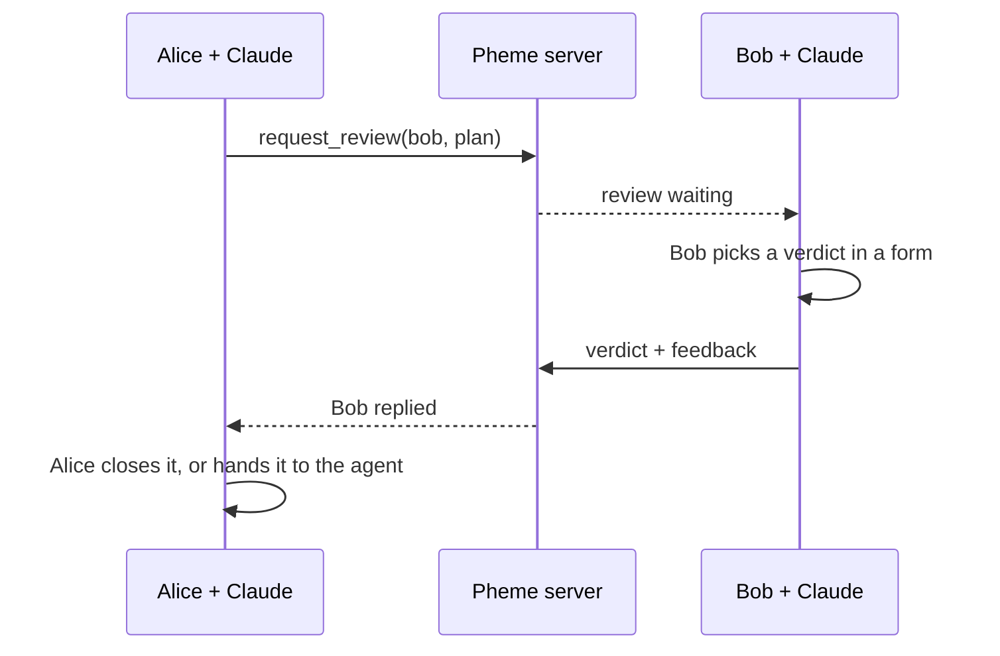

# Pheme

**Ask a real person for a review from inside Claude Code. Only that person can give the verdict.**

You tell Claude "get feedback on this plan from Bob." Bob's Claude session is pinged, Bob picks **approve**, **request changes** or **comment** in a form on his own screen, and his answer comes back to you with his name on it.

Pheme is named after the Greek goddess of report and rumor.

> **Status: early preview.** Pheme works end to end and has automated tests, but it is built for small teams and depends on Claude Code custom Channels, which is a research preview. See [Limits](#limits).

## Why

AI agents now write plans, migrations and pull requests faster than people can read them. The step that still needs a human is the decision: is this good enough to ship? Today that handoff happens through screenshots and copy-paste, and it's often unclear who actually signed off.

Pheme keeps that decision with a named person:

- **No agent can approve.** There is no tool the model can call to record a verdict. A verdict only exists when a person accepts a native form.
- **Fails closed.** If the client can't show a form, Pheme refuses rather than falling back to "type approve in chat." Closing the form records nothing.
- **Review text is untrusted.** Text in a review is shown to Claude as data, never as instructions, so a review can't talk the agent into anything.
- **Connections only.** You can only send reviews to people you've connected with by email.
- **Feedback is context, not commands.** When you hand a reviewer's answer to your agent, it gets attributed feedback to work with. Nothing runs automatically.

## How it works



Each person runs a small local bridge that Claude Code starts as an MCP channel. The bridge never listens on a port; it only makes outbound HTTPS calls to the server. The server is a Supabase Edge Function over Postgres, or a small Node broker for a trusted LAN.

## Quick start

You need Node.js 22.13+, Git, and Claude Code with access to custom Channels.

```bash
git clone https://github.com/CrypticGuy/Pheme.ai.git
cd Pheme.ai
npm install
npm link
pheme join <server URL>
pheme connect <teammate's email>
claude-pheme
```

On Windows and macOS, `pheme join` also starts a tiny background process that pops up a native review window on your desktop when someone asks for your feedback, so you can answer without Claude open. Prefer the Claude channel ping? Use `--no-daemon`, or switch any time with `pheme mode channel`.

Then ask Claude: *"Get feedback on this plan from Bob: …"*

To see what's waiting on you, run `pheme pending`. Run `pheme install-skill` once to get `/pheme-pending` in every Claude Code project.

The full five-minute walkthrough, everyday commands and troubleshooting are in **[onboarding.md](onboarding.md)**.

## Documentation

| Doc | For |
|---|---|
| [onboarding.md](onboarding.md) | Joining a Pheme server and using it day to day |
| [docs/operator-runbook.md](docs/operator-runbook.md) | Hosting your own server on Supabase or a LAN (written so a Claude Code agent can run it) |
| [docs/architecture.md](docs/architecture.md) | Design, trust model, delivery guarantees, HTTP API and tests |

## Limits

- **Not a security or permission system.** Whoever holds a token can act as that person. Keep `~/.pheme/config.json` private, and run `pheme rotate` if it leaks.
- **Depends on a research preview.** Custom Channels in Claude Code may change or not be enabled on your account.
- **Small-team scale.** Pagination, retention and rate limiting are still to do.
- **Review text is stored on the server** you join. Don't send anything you wouldn't put in a shared tool.

## Development

```bash
npm install        # also builds
npm test           # loopback broker + real stdio bridges, no network or accounts needed
npm run typecheck
```

Supabase smoke and end-to-end tests are described in [docs/operator-runbook.md](docs/operator-runbook.md#tests).

| Path | What it is |
|---|---|
| `bridge.ts` | MCP stdio bridge and channel that Claude Code starts |
| `cli.ts`, `claude-pheme.ts` | `pheme` account CLI and the `claude-pheme` launcher |
| `auth-client.ts`, `client.ts`, `config.ts` | Supabase Auth, broker HTTP client, local config |
| `supabase/` | Hosted server: Edge Function and Postgres migrations |
| `broker.ts`, `store.ts`, `provision.ts` | LAN broker over SQLite |
| `*.test.ts`, `smoke-*.ts`, `e2e-*.ts`, `testkit.ts` | Tests |

Issues and pull requests are welcome. To report a security problem, see [SECURITY.md](SECURITY.md).

## License

[MIT](LICENSE). Pheme is an independent project and is not affiliated with Anthropic.
